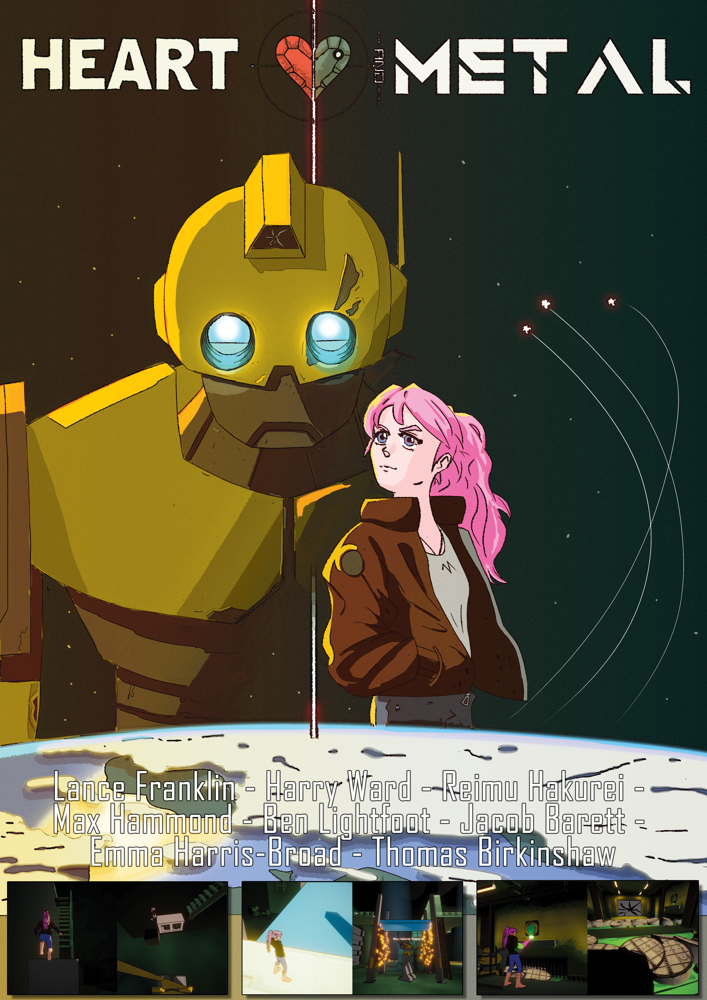

**Heart and Metal** is a 2 player cooperative game where one player plays as a princess and the other as a robot. Players must work together to navigate a factoy game space.

**Heart and Metal** was created as a final year project with Lance Franklin, Harry Ward, Reimu Hakurei, Max Hammond, Ben Lightfoot, Emma Harris-Broad, and Thomas Birkinshaw.

